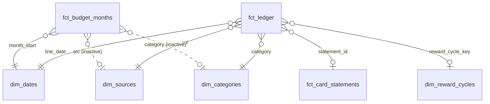
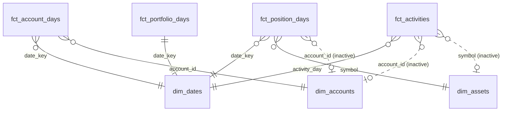

# Semantic layer

The AML in `models/` and `datasets/` turns the synthetic cspipeline replica (`db/finance.duckdb`)
into governed metrics that apps and agents query by name. Every value in the data is synthetic.

- **One definition per number.** An app asks for `savings_rate` or `daily_spend_needed`; it never
  re-derives money logic in JavaScript.
- **cspipeline parity.** Each definition matches the real pipeline's own code (`store.py`,
  `cashback.py`), and `tests/check_semantic.py` proves it on every run.
- **Clear boundary.** `db/` is a faithful source replica (parity-checked DDL, untouched). New
  business rules (the flow taxonomy, reward cycles, budget overflow, local dates) live only in
  AML, so `anfra show` documents them.

## Layers

| Layer | Where | What |
|---|---|---|
| Source | `db/finance.duckdb` | 7 of the 8 cspipeline tables (no `settlements`) and its 5 views, plus the 4 investment-layer tables, synthetic values |
| Raw | `models/raw/`, dataset `finance_raw` | One model per table, every column documented, no rules. For audit and lineage |
| Semantic | `models/dims/`, `models/facts/`, dataset `personal_finance` | Star schema, 63 public metrics (+7 hidden helpers) |
| Semantic | `models/dims/`, `models/facts/`, dataset `wealth` | Galaxy schema for the Wealthfolio clone, 59 public metrics (+3 hidden helpers) |

## Model



| Model | Grain | Built from | Rows |
|---|---|---|---|
| `fct_ledger` | One money line: a card line or an account movement | `card_transactions_tagged` ∪ `account_movements_resolved` | 2,139 |
| `fct_budget_months` | One active budget × one calendar month | Port of `store.budget_progress` | 133 |
| `fct_card_statements` | One card statement (TCB real, VIB synthetic container) | `statements` | 28 |
| `dim_dates` | One local calendar day | Generated from the data's date range | 1,095 |
| `dim_sources` | One money source | Fixed list (cspipeline's `src` keys) | 4 |
| `dim_categories` | One taxonomy tag, plus `(chưa phân loại)` | Fixed list (`taxonomy.TAGS`) | 12 |
| `dim_reward_cycles` | One MAX VIB 16th→15th cycle | `cashback_milestones` (active rate rung) | 9 |

### The ledger and its flow taxonomy

The two sources disagree on signs: a card line is + for spend, while an account movement is
always positive with a D/C direction. The ledger gives every line `amount_vnd` (absolute),
`direction` (out/in relative to the instrument) and `signed_amount_vnd`, then classifies it once:

| `flow_group` | `flow_type` | Rule |
|---|---|---|
| spend | `purchase` | Card line with amount > 0 |
| | `account_spend` | Account debit that cspipeline's `is_spend` keeps |
| | `family_support` | Debit with flow `mom` (money sent to Mom) |
| income | `salary`, `bonus`, `interest` | Credit: `TRA LUONG`, the word `THUONG`, `THANH TOAN LAI` |
| reimbursement | `friend_payback` | TCB credit "chuyen tien" (friends repaying) |
| refund | `card_refund` | Card credit that is not a payment or a points cash-out |
| reward | `reward_redemption` | `vib_reward` line (points cash-out) |
| transfer | `card_payment` | Card bill paid (both sides: the debit and the card's credit) |
| | `own_transfer` | TCB → Timo top-up, and its Timo credit |
| | `pot_move` | Timo money pot contribution or withdrawal |
| save_invest | `saving_deposit`, `term_deposit`, `saving_maturity`, `investment` | Manual savings/investment flows, Timo TD, `TAT TOAN TIET KIEM` |
| other | `other_inflow`, `other_outflow` | Unclassified. Expected empty; check 8 fails otherwise |

cspipeline's own resolved flow is kept as `pipeline_flow` for parity.

## Metric catalog

The metrics in this section are in `personal_finance`; the `wealth` metrics follow below. Money is in đồng.

**Spend (Tiền ra)**
- `spend`: card purchases + real account spend. It equals cspipeline's "Tiền ra" and excludes card bill payments, transfers, pots, saving, investing and `Đã hoàn` charges.
- `net_spend` = spend − refunds − reimbursements.
- By instrument and counts: `card_spend`, `account_spend`, `spend_lines`.
- Averages: `avg_daily_spend` (÷ elapsed days), `avg_ticket`.
- Time comparisons: `spend_prev_month` (`relative_period`), `spend_mom_change_pct`, `spend_mtd` (`period_to_date`).
- `spend_share_pct` (`percent_of_total`).
- Slices: `refunds`, `reimbursements`, `family_support`, `subscription_spend`, `active_subscriptions`, `foreign_currency_spend`.
- `elapsed_days`: calendar days to the as-of date. Since 16 Oct it ignores category and source filters (`of_all(dim_categories, dim_sources)`), so a per-day or per-month average for one category is no longer inflated (Shopee over a year: ₫9.1M a month, not ₫23.7M). `period_days` and `days_left` count the same way.

**Income & saving**
- `income` = salary + bonus + interest, with `salary` and `bonus` also on their own.
- `cash_in`: cspipeline's "Tiền vào", every account credit. It overstates income.
- `external_inflow` = income + reimbursements.
- `saved_and_invested`, `savings_matured`, `net_saving`.
- `surplus` = income − net_spend.
- `savings_rate` = surplus ÷ income; `spend_to_income`; `cash_flow_net` = income − spend (the Spending tab's "Net").
- `cash_flow_net_pct` = cash_flow_net ÷ income: the % to show next to net cash flow (savings_rate uses net spend, so it reads higher).
- `salary_latest` (the last salary, whatever the period) and `income_planned` = income + the latest salary while the period has none yet; `savings_target_planned` = income_planned − category budgets.

**Balances**
- `account_balance`: semi-additive, `max_by(running_balance, balance_seq)` per source.
- `total_cash`: a nested sum over sources.
- TCB statement: `card_statement_balance`, `card_min_payment`, `card_payment_due`.
- Pots: `pot_contributions`, `pot_withdrawals`, `pot_net_flow`.

**Budgets** (port of `store.budget_progress`)
- `budget_limit`.
- `budget_raw_spent` (before overflow) and `budget_spent` (after: a capped category shows its limit, the buffer takes the excess).
- `budget_overflow_to_buffer`, `budget_remaining`, `budget_used_pct`.
- Counts: `budgets_over_limit`, `budgets_at_warning`.
- Against the month so far (16 Oct): `budget_spent_categories`, `budget_remaining_categories` (category scope only), `budget_left_per_day` (÷ `days_left`), `budget_pace_expected` (limit × elapsed ÷ days in period), `budget_pace_gap`, and `budget_pace_status` (over budget · ahead of pace · on track).
- The same base from the ledger: `spend_budgeted` / `spend_budgeted_mtd` (tags where `dim_categories.has_category_budget`) and `spend_unbudgeted` (Hoá đơn, Well-being, Học tập, untagged), so spend = spend_budgeted + spend_unbudgeted and a pace line can be drawn by day.

**Recurring** (`fct_recurring`, a query model over `fct_ledger`)
- One row per series: a raw merchant + source charged at least twice in the last 3 months (Subscription, Hoá đơn), or a payer's salary. `next_due` carries the latest charge day a month forward past the as-of date; `expected_vnd` is the latest amount. An expectation from history, not a schedule.
- `recurring_due_30d`, `recurring_due_30d_count`, `recurring_due_14d`, `recurring_due_14d_count`, `income_expected_30d`, `next_payday`.

**MAX VIB rewards** (port of `cashback.py`)
- `reward_qualifying_spend`.
- `points_earned`: per cycle `min(cap, floor(spend × cap ÷ threshold))`, then summed.
- `points_paid`, `points_pending`.
- `cap_gap` and `points_left_to_cap`.
- `daily_spend_needed` = `ceil(gap ÷ (days_left + 1))`.
- `projected_cycle_spend`, `projected_points`.
- `cycles_maxed`.
- `reward_status`: maxed / on_pace / behind.

**Data quality**
- `lines`, `untagged_spend`, `untagged_spend_lines` (spend lines with no category yet: the Spending tab's "N to tag").
- Coverage: `category_coverage_pct`, `auto_tagged_share`.
- `data_as_of`.
- `data_complete_through`: the earliest of each source's last line. A period ending after it is missing a source's spending (TCB Visa stops on Sep 19 in the replica).

The dataset also declares `breakdown` groups (Time, Where it goes, Card or account) and
`underlying_data` views (the lines behind spend, income, paybacks and points), which an
agent uses to drill into a number.

### Examples

```aql
// MAX VIB: where the current cycle stands
explore {
  dimensions { cycle: dim_reward_cycles.cycle_label }
  measures { spent: reward_qualifying_spend, points: points_earned, to_cap: cap_gap,
             per_day: daily_spend_needed, status: reward_status }
  filters { dim_reward_cycles.is_current is true }
}

// Savings by month
explore {
  dimensions { month: dim_dates.date_key | month() }
  measures { income: income, net_spend: net_spend, surplus: surplus, rate: savings_rate }
  filters { dim_dates.date_key matches @(2026) }
}

// Budget vs actual, envelope style
explore {
  dimensions { budget: fct_budget_months.scope_label }
  measures { limit: budget_limit, spent: budget_spent, moved: budget_overflow_to_buffer }
  filters { dim_dates.date_key matches @(2026-09) }
}
```

## The wealth dataset

`wealth` is the Wealthfolio side of the app: accounts, holdings, activities, income and
performance. It reads the investment layer (`accounts`, `assets`, `quotes`, `activities`, built
by `db/invest.py`) together with the cash ledger. `personal_finance` keeps serving spending.



| Model | Grain | Built from | Rows |
|---|---|---|---|
| `fct_account_days` | Account × local day: value (cards negative), cash, holdings, flows, income | `activities` + `fct_position_days` (securities), running balances (TCB debit, Timo), card rows (TCB Visa, MAX VIB) | 4,496 |
| `fct_position_days` | Account × symbol × day: quantity, price, value, cost, P&L, price gain | `activities` × `quotes` (latest close on or before the day) | 4,496 |
| `fct_portfolio_days` | One day of the securities accounts: value, flows, daily and log return, VN-Index | `fct_account_days` (SSI and gold) + `quotes` | 562 |
| `fct_activities` | One activity, in VND | `activities` + `accounts` + `assets`, USD at the latest rate | 37 |
| `dim_accounts` | One account (group: Investments / Cash / Liabilities) | `accounts` | 8 |
| `dim_assets` | One symbol (class, sub-class, sector, country) | `assets` | 9 |

Row counts are at `--end 2026-10-14`. The link from `fct_account_days` to `dim_accounts` is the
only active account link. Holdings, income and activity metrics switch their own account link on
with `with_relationships`, so a filter on `dim_accounts.account_id` narrows them. It does not narrow:
- **the performance metrics**, which describe the SSI and gold accounts as one portfolio by design;
- **a list of `fct_activities` rows** with no metric in it: filter those on `fct_activities.account_id` or `.symbol`.

To break holdings down **by** account, use `account_holdings`, `account_book_cost` and
`account_holdings_count`. The per-symbol totals (`holdings_value`, `book_cost`, `holdings_count`)
fail under a `dim_accounts` dimension in Anfra 0.8.0, but they do break down by asset class, sector
or symbol.

**Metrics (59 public, 3 hidden helpers)**
- **Net worth:** `net_worth_daily` is THE definition: the sum of every account's value on a day, credit cards negative (= `assets_daily` + `debt_daily`). `net_worth` and `net_worth_start` are its value on the last and first day of the period, `net_worth_change` the difference. `assets_daily` / `assets_value` sum every non-liability account. The drivers are `investment_gains` (market moves on positions + dividends + interest, after the period's first day, to match the start value), `saved_from_income` (asset growth that is not investment gains) and `debt_change` (the part of the net worth change that is not assets). Per account: `account_value`, `account_change`, `accounts_value`, `cash_balance`. Pace: `net_worth_monthly_pace` = change ÷ tracked days × 30.4375.
- **Holdings:** `holding_quantity`, `holding_price`, `holding_value` (quantity × price at the end of the period), `holding_book_cost` (what the open position cost, fees included), `holding_unrealized`, `holding_realized` (sale proceeds net of fees − cost, once closed), `holding_return` (unrealized + realized; dividends are income, not return). Totals: `holdings_value`, `book_cost`, `unrealized_pnl`, `holdings_count` (open positions), `price_gain`. By account: `account_holdings`, `account_book_cost`, `account_holdings_count`. `portfolio_value` = holdings + cash, which equals `assets_value` (check w11) and breaks down by account.
- **Income:** `dividend_income` (cash dividends net of the 5% tax withheld), `interest_income` (term-deposit interest at each maturity or renewal), `investment_income` (both: what Wealthfolio's Income tab counts), `income_monthly_avg`, `activities_count`.
- **Performance (SSI and gold only):** `twr` = exp(Σ log returns) − 1; `volatility` = sample stdev of trading-day returns × √250; `max_drawdown` = the worst fall from a running peak of the TWR index inside the selected period, the peak starting at the value before the period; `benchmark_return` (VN-Index); `portfolio_gain_loss` = end − start − net contributions; `simple_return`; `cumulative_twr` and `cumulative_benchmark` for the chart.

```aql
// Net worth and where the change came from, this year
explore {
  measures { nw: net_worth, change: net_worth_change, gains: investment_gains,
             saved: saved_from_income, debt: debt_change }
  filters { dim_dates.date_key matches @(2026) }
}

// Holdings table
explore {
  dimensions { symbol: dim_assets.symbol, name: dim_assets.name }
  measures { qty: holding_quantity, price: holding_price, value: holding_value,
             cost: holding_book_cost, ret: holding_return, ret_pct: holding_return_pct }
}
```

## Decisions

| Decision | Why |
|---|---|
| **One ledger fact**, not separate card and account facts | Spend and income cross both sources. One fact with one sign convention makes `spend` a plain sum and lets any dimension (merchant, hour, category) slice both |
| **Spend counts at purchase**, a card bill payment is a `transfer` | Otherwise every card purchase would count twice: when bought, and when the bill is paid |
| **`net_spend` beside `spend`** | `spend` matches cspipeline's "Tiền ra". `net_spend` is what Ha actually bore after refunds and what friends paid back, so the savings rate uses `net_spend` |
| **`income` beside `cash_in`** | cspipeline's "Tiền vào" adds own transfers, pot withdrawals and maturities to income. `cash_in` is kept for parity; analysis uses `income` |
| **Local dates in SQL** | Anfra's DuckDB session runs in UTC. A movement at 06:30 in Vietnam is the previous day in UTC. Every date is converted with `AT TIME ZONE 'Asia/Ho_Chi_Minh'` in the model, so results are identical under any `--timezone` (check 10) |
| **"Today" = data as-of date** | Pace, days left and per-day averages use the last date with data, not the wall clock. A dashboard opened a week after a rebuild still reads right, and the numbers are reproducible |
| **Reward rules read from `cashback_milestones`** | The 8% rate, ₫12.5tr threshold, 1M cap and close day 15 come from the table, not the code. A new plan is a row, not a release |
| **Budgets as a monthly snapshot mart** | cspipeline's envelope overflow (capped categories spill into one buffer) needs the whole month's categories at once, which AQL can't do cleanly. The SQL port is checked against AQL `spend` (check 6) |
| **Budget links inactive + `with_relationships`** | Anfra rejects any loop of active relationships. Ledger and budgets share three dims, so the budget→category and budget→source links are off and every budget metric turns them on |
| **No chi chung / chi riêng** | Ha lives alone, so cspipeline's split (`annotations.split`, `settlements`, the partner's payback) is left out of the replica on purpose. A parity check against cspipeline's schema (kept private, as it needs the real DDL) lists the removed columns and still checks every other one |
| **Category groups and colours in `dim_categories`** | Analyst additions, not cspipeline fields. Every app paints a category the same colour and can roll up to Essentials / Lifestyle / Saving & investing |
| **Net worth is one definition, `net_worth_daily`** | Net worth, its start, its change, the chart and `debt_change` are all built on it, and the drivers are defined to sum: `investment_gains` + `saved_from_income` + `debt_change` = `net_worth_change` (check w5). Changing one line moves every net worth number together: the video's edit (a) appends `\| where(dim_accounts.is_liability is false)` to `net_worth_daily` (spec §7), and `debt_change` drops to 0 while the other drivers still sum |
| **Performance covers the securities accounts only** | Salary landing in TCB is not an investment return. Leaving the cash accounts out avoids Wealthfolio's "mixed mode", where flows and returns can't be told apart |
| **Max drawdown is period-scoped** | Nested `running_total` + `window_max` inside `unique(dim_dates.date_key) | select(…)` restart at the filter's first day, so the drawdown is inside the selected period. A spike proved it against plain SQL, and check w6 against a Python replay |

## Verification

```sh
db/.venv/bin/python -I tests/check_semantic.py     # stop `anfra serve` first (DuckDB lock)
```

It runs 11 checks. Each compares AQL against a reference built outside the semantic layer:
direct SQL on the replica, or a Python port of cspipeline's rules.

1. **Ledger grain:** one row per card line (`Đã hoàn` excluded) and per account movement, unique ids.
2. **Monthly totals:** `spend` per month and source matches cspipeline's "Tiền ra" (card purchases + `is_spend` account debits).
3. **Additivity:** Σ category = Σ source = `spend`.
4. **MAX VIB:**
   - points per cycle match `cashback._reward_at`;
   - every closed cycle's cash-out equals its points;
   - the current cycle's pace, projection, ₫/day and status match `milestone_progress`.
5. **Savings:** `surplus` and `savings_rate` per month = income − (spend − refunds − friend paybacks), with income and friends read from `persona.py`.
6. **Budgets:**
   - raw = spend in scope;
   - categories cap at their limit;
   - the buffer = its own spend + Σ overflow.
7. **Balances:** each account's balance = its last running balance; `total_cash` = their sum.
8. **Taxonomy:** every line has a flow group; spend group ⇔ `is_spend`; `cash_in` = all credits.
9. **Raw counts:** `finance_raw` row counts = the tables.
10. **Timezone:** results are identical under `Etc/UTC` and `Asia/Ho_Chi_Minh`.
11. **Income:** every employer credit (name from `persona.py`) is salary or bonus; every friend's credit is a payback, and no other inflow is income or a reimbursement.

Check 11 exists because the first run caught a bonus regex: `\b` doesn't survive inside an AML
SQL heredoc, so Tết and mid-year bonuses fell out of income. Rules in AML SQL avoid backslashes.

```sh
db/.venv/bin/python -I tests/check_wealth.py       # the wealth dataset, same rule: stop `anfra serve` first
```

`check_wealth.py` runs 13 more checks. Its reference is an independent Python replay of
`activities`, `quotes`, `fx_rates`, `bank_movements` and the card rows: no AML, no window SQL.

- **w1. Holdings:** at the as-of date, quantity, price, value, book cost and P&L per position = the replay × the latest close. The closed position (HPG) shows quantity 0 and realized P&L = proceeds − cost.
- **w2. Cash:** cash per investment account (USD at the latest rate on or before the day) and `cash_balance` = the replay.
- **w3. Accounts:** every account's value = the replay (bank = last running balance, cards = minus the debt).
- **w4. Net worth curve:** `net_worth_daily` on sampled days, including a Sunday and the first day = the full replay of every account.
- **w5. Net worth:** end, start and each driver (`investment_gains`, `saved_from_income`, `debt_change`) = the replay over 4 ranges, one starting on a day with a market move; the drivers sum to `net_worth_change`.
- **w6. Performance:** `twr`, `max_drawdown`, `benchmark_return` and `volatility` = Python chain-linking of daily values, for all time, the last 90 days, and a one-day and a longer range that start on a down day.
- **w7. Income:** dividend and interest income per month = the DIVIDEND and INTEREST activities.
- **w8. Timezone:** monthly net worth and holdings are identical under `Etc/UTC` and `Asia/Ho_Chi_Minh`.
- **w9. Activities:** counts by type = the `activities` table.
- **w10. Spending tab:** `untagged_spend_lines` = a SQL count, and `cash_flow_net` = income − spend (in `personal_finance`).
- **w11. Portfolio identity:** `portfolio_value` (holdings + cash) = `assets_value` (every non-card account).
- **w12. By account:** `account_holdings`, `account_book_cost`, `account_holdings_count` and `portfolio_value` per account = the replay.
- **w13. TCB Visa debt:** every day = the last statement's outstanding + new card rows − bill payments since it closed, read from the statements, so a payment made before the next statement isn't counted twice.

## Agents (MCP)

With `anfra serve` running, an agent at `http://127.0.0.1:7878/mcp` sees both datasets:
- `core.show` lists every field and metric with its definition;
- `core.query` runs AQL;
- `core.search` finds fields by keyword.

Searching `savings` finds `savings_rate`, `cap` finds `daily_spend_needed`, and `Mom` finds
`family_support`. Run `anfra ingest` once while the server is up. Search is keyword-based, so
use words, not sentences. In anfra 0.8.0 the CLI `anfra search` prints nothing, while the same
search over the server API and MCP works.

## Known limits

- **Net worth lives in `wealth`, not `personal_finance`.** In `personal_finance`, term deposits,
  gold and stocks are money moved, not valued.
- **Pot balances** are net flows since tracking began. The data has no opening pot balances.
- **MAX VIB debt** isn't stored: VIB alerts carry purchases only, and repayments show as TCB
  debit card payments. `wealth` derives it as non-reversed purchases − points cash-outs −
  repayments from TCB (flow `othercard`). TCB Visa debt is card rows that aren't bill payments −
  bill payments from TCB debit and Timo (flow `settlement`), so a payment counts the day it leaves
  the bank, not when the next statement shows it.
- **Unbilled TCB Visa purchases** aren't in the debt: TCB card rows arrive with the monthly
  statement, so purchases after the last close (the 20th) show up only when the next one lands.
- **Timo pots aren't an account** in `wealth`, so net worth leaves out pot money.
- **Two kinds of timestamp.** `fct_ledger.line_at_local` and `fct_activities.activity_at_local` are Vietnam wall-clock times with no zone: right in a UTC query (the CLI), but an app created with `timezone: 'Asia/Ho_Chi_Minh'` shifts them a second time (+7 h). Apps use the instants `line_at` / `activity_at`, which the query's timezone localizes.
- **A USD revaluation** (the rate moving on the USD cash) lands in `saved_from_income`, not in
  `investment_gains`.
- **Book cost is the sum of costs.** That is exact only because the one sale closes a whole
  position that is never bought again, which a build invariant enforces.
- **"Start of period"** values in `wealth` are the first day in the range, after that day's movements.
- **`account_balance`** is the balance after the period's last movement. A month without a
  movement on an account has no value for it (no carry-forward).
- **Budgets** cover every month from the first data month, including months before MAX VIB opened
  (Jan 2026), when the VIB budget shows ₫0 spent.
- **Month in progress:** `spend_mom_change_pct` compares a partial month with a full one, and
  the month before payday (the 24th) shows spend with no income yet.

## Findings worth acting on

- **The overflow buffer can never absorb anything.** Khác is the buffer, and the ₫10tr a month
  sent to Mom is tagged Other, which is ₫180tr of Other's ₫215tr over 18 months. Other is over its
  ₫3tr limit in all 18 complete months, so every category's overflow lands in a budget that is
  already over. Give family support its own tag, or move the buffer to a category with headroom.
- **Category coverage is 94% of spend.** The untagged ₫36tr is mostly TCB debit (₫16tr of QR
  payments and self-transfers waiting for review) and the two cards (₫17tr).
